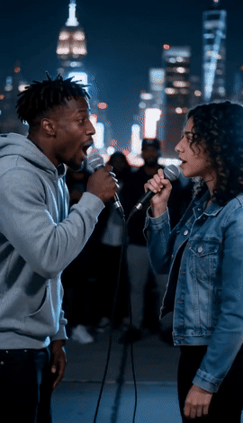
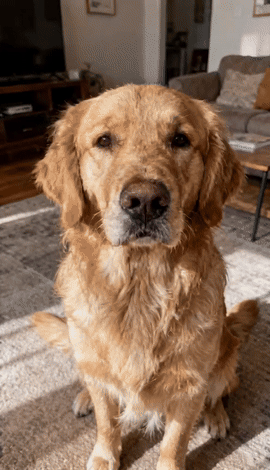

# Rap Anyone — AI Rap Video Generator

**[rapanyone.com](https://rapanyone.com)** turns a photo into an AI rap music video.
Make anyone rap: you, your friends, your dog, or a character you drew.

  
  

## What it does

- **Pick a scene**: a city rooftop, a '90s West Coast street, an '80s block party, the Hotel Lobby booth, or a rap battle ring.
- **Add a photo**: one person, two people (duo or battle), a pet, or a crew.
- **Get the bars**: Rap Anyone writes lyrics about the person in the photo, raps them in an AI voice and lip-syncs the photo into a vertical music video.

Free 4-second preview (480p, watermarked); full videos use credits.

## Free tools

- [Rap Lyrics Generator](https://rapanyone.com/rap-lyrics-generator)
- [Diss Track Generator](https://rapanyone.com/diss-track-generator)
- [AI Rap Battle Generator](https://rapanyone.com/ai-rap-battle-generator)
- [Birthday Rap Video](https://rapanyone.com/birthday-rap-video)

## Rules

Every video is AI-generated and labeled as such. Only upload photos of yourself or people who said yes — no celebrities, politicians or minors.

## Feedback

Issues and ideas are welcome in this repo, or email support@rapanyone.com.
